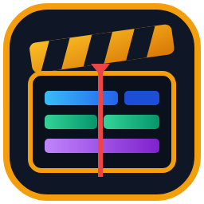

# SpliceWright — Local-First AI Movie & Video Editor



[](./LICENSE)
[](https://github.com/Les-Ey/Video-Editor/releases/latest)
[](https://github.com/Les-Ey/Video-Editor/releases/latest)
[](https://www.buymeacoffee.com/les.ey)

**SpliceWright** is a local-first, zero-SaaS desktop video editor built with **Electron, React, TypeScript, and FFmpeg**. It is designed both as the companion finishing & assembly bay for the **SpliceWright Studio** VS Code extension (`ai-movie.json`) and as a standalone, portable folder-based multi-track video editor that runs cleanly off internal drives or external SSDs.

---

## Support the Project

If **SpliceWright** saves you time assembling AI movies, storyboards, and voiceovers, consider supporting development:

[](https://www.buymeacoffee.com/les.ey)

* **Buy Me a Coffee:** [https://www.buymeacoffee.com/les.ey](https://www.buymeacoffee.com/les.ey)

---

## Key Features

### 1. Native Interop with SpliceWright Studio (`ai-movie.json` Read-Only)

* **100% Non-Destructive Monitoring:** Reads `ai-movie.json` strictly as Read-Only (`R/O`) while saving all editor timeline state and outputs inside `exports/video-project.json`.
* **1-Click Scene Take Switcher:** Switch between multiple generated video takes (`scene.videos[]`), storyboard takes, or `first-frame.png` poster holds directly on each timeline clip.
* **Smart Sync & Ripple:** Automatically watches `ai-movie.json` (respecting `editorState` while generations are in flight) and lets you merge new takes, dialogue, and scene timing updates without losing your custom BGM, SFX, or take selections.
* **Live External Agent Mode:** Watches `exports/video-project.json` so a VS Code AI Agent can perform bulk timeline edits on disk while **SpliceWright** hot-reloads the timeline live on screen (with `Ctrl+Z` Undo support).

### 2. Intelligent Visuals, Camera Motion & Look Presets

* **Auto-Inferred Ken Burns Camera Motion:** Automatically reads storyboard `cameraDirection` cues (`zoom-in`, `zoom-out`, `pan-top-to-bottom`, `pan-left-to-right`, etc.) and applies smooth 2× supersampled `zoompan` motion to still poster frames.
* **Non-Destructive Visual & Vintage Audio Look Presets:** Apply project-wide looks—including *Cinematic Contrast*, *Noir Monochrome*, *1920s Vintage Film (Sepia + Temporal Grain + Vignette)*, *Old Film + Vintage Projector Audio (`300Hz–3.2kHz` band-pass + compressed dynamic range)*, and *Muted Documentary*—both in live preview and during FFmpeg export.
* **Multi-Aspect Ratio Support:** Switch freely between `16:9` (1920×1080), `9:16` Vertical (1080×1920), `1:1` Square (1080×1080), `21:9` Cinema (2560×1080), and `4:3` Classic (1440×1080).

### 3. Pro Audio Leveling, Auto-Ducking & Master MP3 Pre-Mix

* **1-Click Narration Leveling (`dynaudnorm`):** Lifts quiet ElevenLabs sentence endings and tames clip-to-clip volume jumps non-destructively into `assets/audio/normalized/`.
* **1-Click All-Track Audio Leveling (`+SFX/BGM`):** Balances SFX peaks and applies EBU R128 integrated loudness (`loudnorm=I=-16:TP=-1.5:LRA=11`) to Backing Music so different songs match in volume without flattening musical dynamics.
* **Auto-Duck BGM Under Dialogue:** Automatically dips backing music volume (default `25%`) whenever dialogue is active, with independent visual **Fade-In / Fade-Out** envelopes on every audio clip.
* **Invisible Master MP3 Pre-Mix:** Pre-render dense multi-track audio into `exports/.cache/preview-audio-mix.mp3` for zero-lag live preview playback.

### 4. Multi-Lane Timeline, Dual Monitor Mode & Long-Form Movie Stitcher

* **Automatic Overlapping SFX Sub-Lanes:** Overlapping clips on SFX, Dialogue, or Music tracks automatically pack into separate horizontal sub-lanes with a per-track **Expand / Collapse** toggle and vertical scrollbar.
* **Dual Monitor Support (`2nd Screen` Mode):** Pop out a dedicated full-screen Program Monitor onto your secondary display while the Media Bin, Clip Inspector, and Multi-Track Timeline expand side-by-side across Monitor 1.
* **Master Chapter Stitcher & Production Catalogue (`movie-catalogue.json`):** Build 20-minute to 1-hour+ movies across separate chapter/location folders, track live chapter readiness (`🟢 Ready`, `🟡 Outdated Render`, `⚪ Unrendered Draft`), and lossless-stitch (`-c copy`) all chapters + time-shifted `.srt` subtitles in seconds.
* **Pro NLE Hand-Off (`.fcpxml`):** Export Final Cut Pro XML (`.fcpxml` v1.9) alongside your rendered `.mp4` and `.srt` to open the timeline directly in **DaVinci Resolve**, **Adobe Premiere Pro**, or **Final Cut Pro**.

---

## Keyboard Shortcuts

| Shortcut | Action |
| --- | --- |
| `Space` | Play / Pause timeline |
| `Ctrl+Z` (or `Cmd+Z` on Mac) | Undo (reverts entire clip drag/trim in a single atomic step) |
| `Ctrl+Y` / `Ctrl+Shift+Z` (`Cmd+Shift+Z`) | Redo |
| `Delete` / `Backspace` | Delete selected clip (and clean up associated scene markers / ripple) |
| `F` / Double-Click Stage | Toggle Full Screen Program Monitor |
| `J` / `K` / `L` | Rewind 1s (`J`), Pause (`K`), Play (`L`) |
| `←` / `→` | Step playhead 1 frame (`0.05s`), or `1.0s` with `Shift + ←/→` |
| `Home` | Jump playhead to start (`00:00.0`) |

---

## Quick Start (Development & Building)

### Prerequisites

* **Node.js** 18+ and **npm**
* **Windows 10/11**, **macOS 12+ (Apple Silicon & Intel)**, or **Linux (Ubuntu/Debian/AppImage)**
* FFmpeg and FFprobe binaries are bundled automatically for your OS via `ffmpeg-static` and `ffprobe-static` during `npm install` (with automatic fallback to system/Homebrew `ffmpeg` if needed).

### Install & Run (All Platforms)

```bash
cd SpliceWright
npm install
npm run start
```

### Build Installers for Windows, macOS & Linux

```bash
cd SpliceWright

# Windows (generates Setup.exe installer + Portable.exe)
npm run dist:win

# macOS (run on macOS — generates .dmg + .zip with Apple VideoToolbox GPU support)
npm run dist:mac

# Linux (run on Linux — generates .AppImage + .deb)
npm run dist:linux
```

> **Automated Multi-OS Cloud Builds:** This repository includes [`.github/workflows/build-releases.yml`](./.github/workflows/build-releases.yml), which automatically builds Windows, macOS, and Linux installers in parallel on GitHub Actions whenever you push a `v*` tag (e.g. `git tag v1.0.0 && git push origin v1.0.0`) or trigger **Run workflow** in the GitHub Actions tab.
>
> **macOS First-Launch Note (Unsigned Open-Source App):** If macOS Gatekeeper shows an *"unidentified developer"* prompt when opening `SpliceWright.app`, either **Right-Click → Open** in Finder or run:
>
> ```bash
> xattr -cr /Applications/SpliceWright.app
> ```
>
> **Linux AppImage Note:** Make the `.AppImage` executable before launching:
>
> ```bash
> chmod +x SpliceWright-*.AppImage && ./SpliceWright-*.AppImage
> ```

---

## Documentation

* **[SpliceWright User Manual](./docs/USER-MANUAL.md)** — Complete guide to installation, Studio sync, timeline editing, audio leveling, dual-monitor mode, and long-form chapter stitching.

---

## License

Licensed under the **GNU General Public License v3.0 (GPL-3.0-or-later)**. See [LICENSE](./LICENSE) for full details.

[](https://www.buymeacoffee.com/les.ey)
