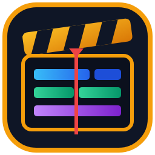

# SpliceWright — User Manual



Welcome to **SpliceWright**, the local-first desktop video editor for **SpliceWright Studio** AI movie projects and standalone media folders.

---

## Table of Contents

1. [Installation & Launching](#1-installation--launching)
2. [Choosing Your Workflow](#2-choosing-your-workflow)
3. [Workspace Overview](#3-workspace-overview)
4. [Working with the Timeline](#4-working-with-the-timeline)
5. [Scene Takes, Still Posters & Ken Burns Camera Motion](#5-scene-takes-still-posters--ken-burns-camera-motion)
6. [Audio Mixing, Auto-Ducking, Fades & Leveling](#6-audio-mixing-auto-ducking-fades--leveling)
7. [Visual & Vintage Audio Look Presets](#7-visual--vintage-audio-look-presets)
8. [Dual Monitor Mode (`2nd Screen`) & Full Screen](#8-dual-monitor-mode-2nd-screen--full-screen)
9. [Exporting Movies, Subtitles (`.srt`) & Pro NLE Timelines (`.fcpxml`)](#9-exporting-movies-subtitles-srt--pro-nle-timelines-fcpxml)
10. [Long-Form Movies: Master Chapter Stitcher & Production Catalogue](#10-long-form-movies-master-chapter-stitcher--production-catalogue)
11. [Keyboard Shortcuts Reference](#11-keyboard-shortcuts-reference)

---

## 1. Installation & Launching (Windows, macOS & Linux)

### Windows

* **Windows Installer (`SpliceWright-1.0.0-Setup.exe`):**
  * Run the installer, choose your installation directory, and launch **SpliceWright** from your Desktop or Start Menu shortcut.
* **Portable Executable (`SpliceWright-1.0.0-Portable.exe`):**
  * Requires no installation. Copy it onto any drive (including an external SSD) and double-click to launch.

### macOS (Apple Silicon & Intel)

* **DMG / ZIP (`SpliceWright-1.0.0-arm64.dmg` / `x64.dmg`):**
  * Open the `.dmg` and drag **SpliceWright** to `/Applications`.
  * **Gatekeeper Tip (Unsigned Open-Source Build):** On first launch, either **Control-Click (Right-Click) → Open** on `SpliceWright.app`, or clear the quarantine attribute in Terminal:

    ```bash
    xattr -cr /Applications/SpliceWright.app
    ```

  * **Hardware Acceleration:** **SpliceWright** automatically detects Apple's `h264_videotoolbox` hardware encoder on macOS for fast video exports.

### Linux (Ubuntu / Debian / AppImage)

* **AppImage (`SpliceWright-1.0.0-x86_64.AppImage`):**
  * Make the file executable and run it directly:

    ```bash
    chmod +x SpliceWright-*.AppImage
    ./SpliceWright-*.AppImage
    ```

* **Debian / Ubuntu Package (`SpliceWright-1.0.0-amd64.deb`):**

    ```bash
    sudo apt install ./SpliceWright-1.0.0-amd64.deb
    ```

### Command-Line Launch (from SpliceWright Studio or Terminal)

* Pass any project folder (or `ai-movie.json` file path) to open it automatically on startup:

  ```bash
  # Windows
  SpliceWright.exe --project "E:\Movies\MyProject"

  # macOS
  /Applications/SpliceWright.app/Contents/MacOS/SpliceWright --project "/Users/you/Movies/MyProject"

  # Linux
  ./SpliceWright-1.0.0-x86_64.AppImage --project "/home/you/Movies/MyProject"
  ```

---

## 2. Choosing Your Workflow

On the Welcome Screen, you can start in one of three ways:

1. **Open SpliceWright Studio Folder (`ai-movie.json`):**
   * Select a project folder created by the **SpliceWright Studio** VS Code extension.
   * **SpliceWright** reads `ai-movie.json` strictly as **Read-Only (`R/O`)**—it never modifies your Studio story file.
   * All scenes, video takes, storyboard takes, `first-frame` posters, ElevenLabs dialogue lines, and SFX/camera cues are assembled onto the multi-track timeline automatically.
   * All timeline edits and rendered outputs are saved inside `exports/video-project.json` and `exports/`.
2. **Standalone Folder Mode (with Optional 1-Click `Convert to Studio Project`):**
   * Select any folder on your computer or external SSD.
   * Import your own video clips (including OBS `.mkv` recordings with embedded Chapter Markers), still images, voiceovers, backing music, and sound effects. Imported media is organized inside `assets/video/` and `assets/audio/` so your project remains 100% self-contained.
   * **Convert to Studio Project:** Because `ai-movie.json` does not exist yet in a Standalone folder, you can click **`Convert to Studio Project`** in the top bar (or inside **`Tools & Project ▾`**) at any time to generate `ai-movie.json`, extract `scenes/scene-N/first-frame.png` thumbnails from your timeline clips, and promote the folder into a **SpliceWright Studio** project (which then switches to standard `ai-movie.json R/O` monitoring).
3. **Try Sample AI Movie:**
   * Generates and loads a complete playable sample project (*"Neon Gate"*) so you can explore take switching, Ken Burns motion, audio leveling, and MP4 export immediately.

---

## 3. Workspace Overview

The **SpliceWright** editor is divided into four areas:

1. **Top Header Bar:**
   * **Aspect Ratio Selector:** Switch project output format at any time between `16:9 Widescreen (1920×1080)`, `9:16 Vertical (1080×1920)`, `1:1 Square (1080×1080)`, `21:9 Cinema (2560×1080)`, and `4:3 Classic (1440×1080)`.
   * **Look Preset Selector:** Apply non-destructive visual color grades and vintage audio filters across the project.
   * **Sync Studio / Convert to Studio Project:** Shows **Sync Studio** when monitoring a **SpliceWright Studio** folder, or **Convert to Studio Project** when working in Standalone Folder Mode.
   * **2nd Screen / Save / Export MP4 / Tools & Project ▾:** Direct access to dual-monitor mode, saving `exports/video-project.json`, rendering MP4 video, and the **`Tools & Project ▾`** menu (**Open Project Folder**, **Standalone Folder Mode**, **Convert to Studio Project**, **Stitch Chapters**, and hardware encoder info).
2. **Program Monitor (Top-Left):**
   * Live preview player with double-buffered video decks, Ken Burns camera motion preview, live dialogue captions, timecode readout, and Full Screen mode (`F` or double-click).
3. **Media Bin & Clip Inspector (Top-Right):**
   * **Import Media Bar:** Click **+ Voiceover**, **+ Music**, **+ SFX**, or **+ Video/Img** to import files into your project. The Media Bin automatically scrolls to and highlights (`NEW`) the asset you just loaded.
   * **+ At Playhead:** Places any asset onto its matching track at the current playhead time.
   * **Clip Inspector:** Click any clip on the timeline to inspect and fine-tune its `Timeline Start (s)`, `Source In (s)`, `Source Out (s)`, `Ken Burns Motion`, `Clip Volume`, `Fade In (s)`, and `Fade Out (s)`.
4. **Multi-Track Timeline Editor (Bottom):**
   * Dedicated tracks for **Scene Video / Visuals**, **Dialogue & Voiceover**, **Sound Effects (SFX)**, and **Backing Music (BGM)**, plus an interactive Time Ruler with Scene Headings, Camera Cues, and SFX Cues.

---

## 4. Working with the Timeline

* **Moving & Trimming Clips:**
  * Drag the body of any clip left or right to move its start time on the timeline.
  * Drag the left or right edge handle of a clip to trim its `Source In` or `Source Out` point.
* **Undo & Redo (`Ctrl+Z` / `Ctrl+Y`):**
  * Click **Undo** / **Redo** in the timeline toolbar or press `Ctrl+Z` / `Ctrl+Y` (`Ctrl+Shift+Z`).
  * Entire clip drags and trims are recorded as a single atomic Undo step.
* **Splitting & Deleting Clips:**
  * Position the red playhead inside a selected clip and click **Split Clip at Playhead** to cut it into two independent clips.
  * Press `Delete` or `Backspace` (or click **Delete Clip**) to remove the selected clip. Deleting a scene video clip also removes its ruler Scene Heading and ripples subsequent scenes left if **Ripple Scenes & Headings** is checked.
  * You can also click the `×` button on any ruler marker badge to remove an individual cue or empty scene heading.
* **Ripple Scenes & Headings:**
  * When **Ripple Scenes & Headings** is checked, moving, trimming, or deleting a scene clip automatically moves its Scene Heading, dialogue clips, and all downstream scenes together so scenes stay sequential without overlaps or gaps.
* **Overlapping SFX & Audio Sub-Lanes (Vertical Expand):**
  * When two or more SFX, Dialogue, or Music clips overlap in time on the same track, **SpliceWright** automatically places them on separate horizontal sub-lanes and shows a **`N lanes`** badge in the track header.
  * Click the **`▼` / `▲` Expand / Collapse** button on any track header to expand the track vertically (with an automatic vertical scrollbar for dense multi-layered SFX tracks).

---

## 5. Scene Takes, Still Posters & Ken Burns Camera Motion

* **Text Overlays (Still Images and Video):**
  1. Put the playhead where the text should start and click **Add Text** in the timeline toolbar. Playback pauses, and the Clip Inspector opens a text box.
  2. Enter your text (including line breaks). The default is bold white Sans Serif with a black outline. **Font**, **Size (px)**, and **Colour** controls are available when needed. Enable **Text background** to add a coloured box behind the text, then choose its colour and transparency (0% opaque, 100% transparent).
  3. Drag the text directly in the **Program Monitor** to position it. Text stays in screen coordinates, independent of the underlying still's zoom/pan or video playback. Switch off **2nd Screen** temporarily to position text in the main editor.
  4. Move the purple clip on the **Text Overlays** track to change its start; drag either edge to trim its duration. You can also edit **Start (s)** and **Duration (s)** in the Inspector, split or delete text clips, and hide/show the text track. **Undo/Redo** supports these changes, including a complete positioning drag as one action.
  * New text starts at the playhead for up to five seconds (or the remaining current visual clip, with a quarter-second minimum). Text can span multiple image/video clips or extend over a black timeline gap.
  * Long lines wrap within the output frame. Oversized text is clipped to the frame; reduce its font size or split it into shorter overlays when necessary.
  * **Save** stores editable text, position, style, and timing in `exports/video-project.json`, not in the original image/video. MP4 export uses the same rendered text as the Program Monitor. Text is separate from **Live Captions** and is **never added to SRT subtitles or the audio mix**.
  * **Studio scene defaults:** Studio may supply an optional multiline `scene.defaultTextOverlay`. Nonempty text is imported once, spanning that scene's visual timeline range, using the same editable text feature. After import the editor owns it: edits, styling, timing, and deletion survive later syncs, reopening, and Studio rebuilds, even if Studio changes or removes its default. New defaults added to existing scenes are offered through Studio sync (or imported when reopening). Missing/blank defaults leave older projects unchanged.
* **1-Click Scene Take Switching:**
  * When a scene has multiple video takes (or a `first-frame.png` poster), a **Take Selector dropdown** appears directly on the blue scene clip in the timeline. Select any take from the dropdown to switch the active shot immediately.
* **Still Image Backgrounds:**
  * Select an image or poster clip and choose **Image Background** in the **Clip Inspector**: **Plain (Black)**, **Mottled** (a subtle dark texture), or **Softened Image** (a blurred, darkened copy of that clip's still).
  * The **Apply to all images?** prompt offers **This image only**, **Apply to all images**, or **Cancel**. Applying to all changes existing image clips on the timeline, including other scenes, but not videos or placeholder slates. Each softened background uses its own clip's image.
  * Backgrounds stay stationary while foreground zoom/pan runs, in the Program Monitor and MP4 export. Fit/Stretch and camera-motion settings are preserved. Save the project to keep the choices in `exports/video-project.json`; no Studio manifest changes or source-image edits are needed. Existing projects default to black.
* **Fit / Stretch Modes & Camera Motion (Ken Burns + Star Wars Crawl):**
  * When a scene uses a still image or poster frame, **SpliceWright** automatically infers a camera motion preset from your storyboard's `cameraDirection`.
  * For tall/narrow screenshots (e.g., long document captures in a `16:9` project) or wide images in a `9:16` project, select the clip and use the **Fit / Stretch Mode (Aspect Ratio Framing)** dropdown in the **Clip Inspector**:
    * `1. Fit Inside (Letterbox / Pillarbox — Default)`
    * `2. Stretch to Fill Frame (Stretch Wide 16:9 / Stretch Tall 9:16)` — Stretches narrow clips wide or wide clips tall to fill the entire frame.
    * `3. Fit Full Width (Wide 16:9 — Ideal for Document Scroll)` — Scales narrow/tall document images to full 16:9 width so vertical scrolling fills the entire screen without side pillarboxes.
    * `4. Fit Full Height (Tall 9:16 — Ideal for Horizontal Pan)` — Scales wide clips to full vertical height.
    * `5. Zoom to Fill / Cover (No Black Bars)` — Aspect-ratio-preserving center fill.
  * Combine any Fit Mode with the **Still Image / Camera Motion (Ken Burns & Star Wars Crawl)** dropdown:
    * `1. None (Static Hold)`
    * `2. Slow Zoom In (Center Push-In)`
    * `3. Slow Zoom Out (Pull-Back)`
    * `4a. Pan Top-to-Bottom (Document Scroll)` / `4b. Pan Bottom-to-Top (Reverse Scroll)`
    * `5a. Pan Left-to-Right` / `5b. Pan Right-to-Left`
    * `6a. Zoom In Top-Left` / `6b. Zoom In Top-Right` / `6c. Zoom In Bottom`
    * `7. Star Wars Crawl (3D Perspective Scroll)` — Tilts the image or document in 3D perspective and scrolls it upward into the distance like the classic *Star Wars* opening crawl.
* **Playback Speed (`0.5x` – `4.0x`), Source Audio Mute & OBS `.mkv` Chapter Import (Scenario 1 & 2):**
  * Select any video clip to set its **Playback Speed (`0.5x` to `4.0x`)** (e.g. `3x` or `4x` to fast-forward through silent waiting/typing sections of an OBS screencast after splitting with **Split Clip at Playhead**) and toggle **Mute Source Video Audio**.
  * When importing an OBS `.mkv` recording, **SpliceWright** losslessly remuxes it to `.mp4` (`-c copy`) and detects any embedded OBS Chapter Markers, offering to place non-destructive sub-clips for each chapter onto the timeline.
  * **Automatic Multi-Scene Audio Spanning:** If an Anchor Scene has long narration and the following scenes have no dialogue of their own, those subsequent scenes cut visually on `track_video_main` while the Anchor Scene's narration plays continuously underneath.

---

## 6. Audio Mixing, Auto-Ducking, Fades & Leveling

* **Track Volume & Mute:**
  * Adjust the volume slider (`0%–120%`) or click the speaker icon on each audio track header to mute/unmute the entire track.
* **Auto-Duck BGM Under Dialogue (25%):**
  * Keep **Auto-Duck BGM Under Dialogue (25%)** checked in the timeline toolbar to automatically dip Backing Music volume whenever a Dialogue clip is speaking, and smoothly restore music volume during pauses.
* **Clip Fade-In & Fade-Out:**
  * Music clips automatically default to a `0.5s` Fade In and `1.0s` Fade Out (indicated by diagonal slope shading and a `↗0.5s / 1s↘` badge on the clip).
  * Click any audio clip to adjust **`Fade In (s)`** and **`Fade Out (s)`** in the **Clip Inspector**, or click one of the quick presets: **`No Fade (0s)`**, **`Standard (0.5s / 1.0s)`**, or **`Cinematic (2.0s / 2.5s)`**.
* **Level Narration & Level All (+SFX/BGM):**
  * **Normalise Narration Checkbox:** Applies dynamic audio normalization during MP4 export so quiet sentence endings are lifted.
  * **Level Narration Button:** Runs FFmpeg `dynaudnorm` across all dialogue clips now and saves leveled copies in `assets/audio/normalized/` so live preview also plays leveled speech.
  * **Level All (+SFX/BGM) Button:** Levels Dialogue (`dynaudnorm`), balances SFX clip peaks, and applies **EBU R128 integrated loudness (`loudnorm`)** to Backing Music so different songs match each other in overall volume without flattening musical dynamics.
* **Mix All Audio (MP3) Button:**
  * Pre-mixes all Dialogue, SFX, and BGM tracks (with auto-ducking, fades, and leveling) into a single hidden master `.mp3` (`exports/.cache/preview-audio-mix.mp3`) for ultra-smooth live preview on complex projects.

---

## 7. Visual & Vintage Audio Look Presets

Use the **`Look:`** dropdown in the top header bar to apply a uniform, non-destructive grade across your entire project (both in live preview and during MP4 export):

* **Clean Original (No Look Filter):** Unmodified source colors and audio.
* **Cinematic Contrast & Warm/Cool Grade:** Subtle S-curve contrast with warm highlights and cool shadows.
* **Noir Monochrome (Silver B&W + Vignette):** High-contrast black-and-white with a soft optical lens vignette.
* **1920s Vintage Film (Sepia + Film Grain + Vignette):** Warm vintage tone, lens vignette, and organic temporal film grain during export.
* **Old Film + Vintage Projector Audio:** Combines the 1920s Vintage Film visual grade with a `300Hz–3.2kHz` band-pass audio filter and dynamic range compression to give modern AI voiceovers and music an authentic vintage projector / old radio sound.
* **Muted Documentary (Desaturated Bleach-Bypass):** Lowered saturation with crisp contrast.

---

## 8. Dual Monitor Mode (`2nd Screen`) & Full Screen

* **Full Screen Preview (`F`):**
  * Click **Full Screen** in the Program Monitor, press `F`, or double-click the video canvas to view the Program Monitor (including Ken Burns motion, look filters, live captions, and transport controls) across your full screen. Press `Esc` or `F` to exit.
* **Dual Monitor Mode (`2nd Screen` Button):**
  * Click **`2nd Screen`** in the top header bar to open a dedicated **External Program Monitor** window on your secondary display.
  * While `2nd Screen: ON` is active, the preview pane on Monitor 1 collapses so the **Media Bin (left 62%)** and **Clip Inspector (right 38%)** sit side-by-side above an expanded **Multi-Track Timeline**.

---

## 9. Exporting Movies, Subtitles (`.srt`) & Pro NLE Timelines (`.fcpxml`)

Click **`Export MP4`** in the top-right corner to render your finished video into the project's `exports/` folder:

1. **Speed / Quality Preset:** Choose **Fast Draft**, **Balanced (Recommended)**, or **High Quality Master**.
2. **Hardware / Software Encoder:** Automatically detects available GPU encoders (`h264_nvenc`, `h264_amf`, `h264_qsv`, `h264_mf`) alongside `libx264`.
3. **Synchronized `.SRT` Subtitles:** Automatically generates `exports/<name>.srt` from your Dialogue track with speaker names and timestamps.
4. **Final Cut Pro XML (`.fcpxml`):** Check **Also export Final Cut Pro XML (`.fcpxml`)** to write a `v1.9` timeline XML file that opens directly in **DaVinci Resolve**, **Adobe Premiere Pro**, or **Final Cut Pro**.

---

## 10. Long-Form Movies: Master Chapter Stitcher & Production Catalogue

To create **20-minute to 1-hour+ movies** without overloading a single timeline, organize your movie into separate chapter/location folders (3–6 minutes each), export each chapter to `.mp4` + `.srt`, and click **`Stitch Chapters`** in the top header bar:

* **Scan Production Folder (`movie-catalogue.json`):**
  * Click **`Scan Production Folder (Catalogue)`** and select the parent folder containing your chapter folders.
  * **SpliceWright** discovers every chapter, saves/loads `movie-catalogue.json`, and displays live readiness badges:
    * **`🟢 Ready`** — Rendered `.mp4` is up to date.
    * **`🟡 Outdated Render`** — Chapter timeline or `ai-movie.json` was modified after its last `.mp4` export.
    * **`⚪ Unrendered Draft`** — Chapter has not been exported to `.mp4` yet.
  * Click **`Edit Chapter`** on any row to jump directly into editing that chapter on the timeline.
* **Near-Instant Lossless Stitching (`-c copy`) + Merged `.SRT` Subtitles:**
  * Choose an optional **Black Transition Spacer** (`0.0s`, `0.5s`, `1.0s`, or `2.0s`) between chapters.
  * Keep **Auto-merge & time-shift companion `.SRT` subtitles** checked to generate a single unified `.srt` subtitle file alongside your full-length stitched `.mp4`.

---

## 11. Keyboard Shortcuts Reference

| Key / Shortcut | Action |
| --- | --- |
| `Space` | Play / Pause timeline |
| `Ctrl+Z` | Undo last edit or entire clip drag/trim |
| `Ctrl+Y` / `Ctrl+Shift+Z` | Redo |
| `Delete` / `Backspace` | Delete selected clip (and clean up associated scene headings) |
| `F` / Double-Click Stage | Toggle Full Screen Program Monitor |
| `J` | Step backward `1.0s` |
| `K` | Pause playback |
| `L` | Start playback |
| `←` / `→` | Step playhead `0.05s` (1 frame) |
| `Shift + ←` / `Shift + →` | Step playhead `1.0s` |
| `Home` | Jump playhead to `00:00.0` |

---

## Support SpliceWright

If you enjoy using **SpliceWright**, you can support ongoing development at:
**[https://www.buymeacoffee.com/les.ey](https://www.buymeacoffee.com/les.ey)**
